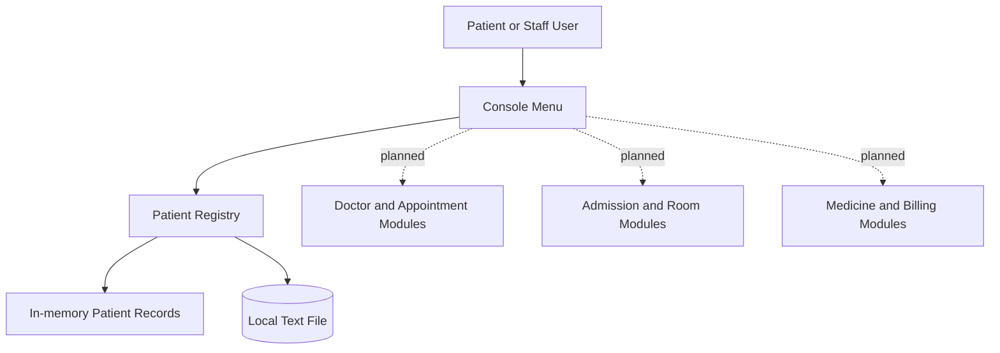

# CareBridge: A C++ Hospital Management System

## Student and Team Information

- **Team name:** Avengers
- **Team members:** Add names and student details in the copy submitted privately to your instructor. Do not publish student IDs or personal email addresses in a public repository.
- **Mentors:** Add mentor details in the copy submitted privately to your instructor.
- **Course name and ID:** To be completed

## Proposal Description

### Motivation

Hospitals coordinate patient registration, appointments, admissions, rooms, medicines, billing, and medical records. Manual or disconnected processes can cause delays, duplicate entries, and difficulty retrieving information. A Hospital Management System can organize these activities in one place, make records easier to find, and support coordination between patients, doctors, and staff. This academic project will explore how programming, data structures, and object-oriented design can support a simplified version of these workflows. The prototype is for learning and demonstration; it is not intended to store real patient data or replace a production hospital system.

### State of the Art and Current Solutions

Hospitals commonly use Hospital Information Systems, electronic medical records, appointment platforms, and separate billing or pharmacy applications. These tools reduce paperwork and improve information access, but can be expensive or split across systems. This project will build a small, integrated academic prototype focused on core concepts rather than matching the scale, security, or regulatory requirements of professional systems.

### Project Goals and Milestones

The goal is to design and incrementally develop a basic Hospital Management System. Initial milestones are to gather requirements, identify key entities, and prepare the system design. The first implementation milestone is a patient registry that supports registration, listing, searching, and local file storage. Later milestones will add doctor records, appointment scheduling, admission and discharge, room management, medicine inventory, and billing. The team will then integrate and test the modules, fix issues, document the system, and demonstrate the completed prototype.

### Project Approach

The system will be developed in C++ using object-oriented programming and suitable data structures and algorithms. Classes or structures for entities such as Patient, Doctor, Appointment, Room, Medicine, and Billing can be introduced as their modules are implemented. The current starter uses a vector for patient records and a text file for local persistence. The console menu supports adding, listing, and searching patient records. Development will proceed in small modules, with testing after each addition. Later work may compare data structures and searching or sorting approaches based on the requirements of each module.

## System Architecture

## Project Outcomes and Deliverables

Deliverables will include the C++ source code, system design, test cases, project documentation, and a demonstration. The initial prototype delivered in this starter supports patient registration, listing, searching, and local file storage. Additional hospital modules are planned milestones and should be implemented and tested before they are described as completed outcomes.

## Assumptions

The project uses sample academic data and a defined set of basic hospital workflows. The prototype is for coursework and demonstration only. It does not provide production-grade privacy, security, availability, or clinical functionality, and must not be used with real patient information.

## References

1. cppreference.com, C++ language and standard library reference: https://en.cppreference.com/
2. Course materials on object-oriented programming.
3. Course materials on data structures and algorithms.
4. General educational resources on Hospital Information Systems.